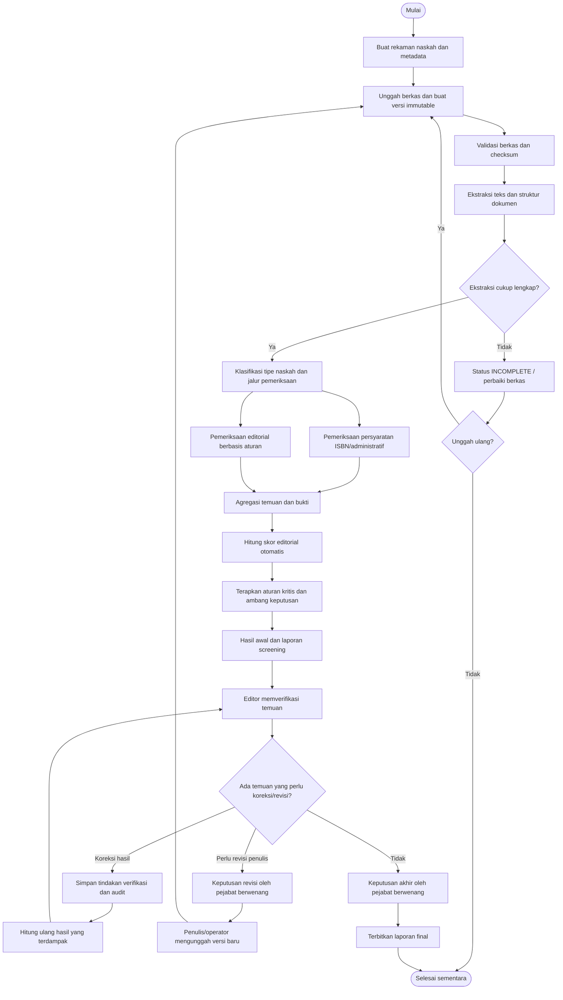
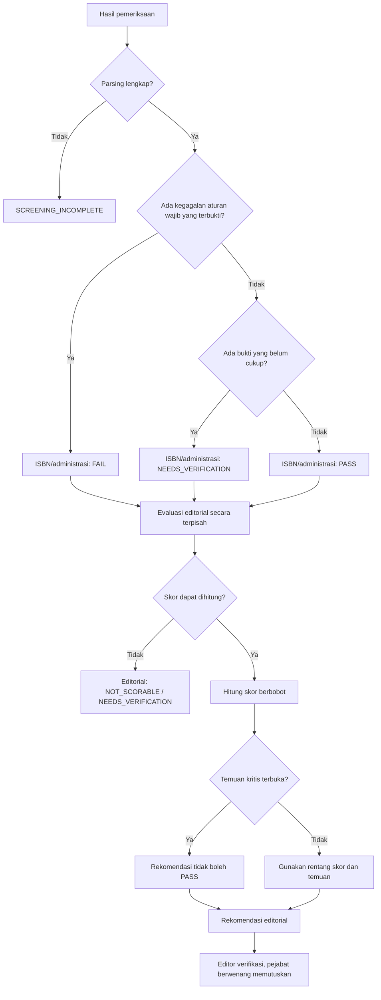
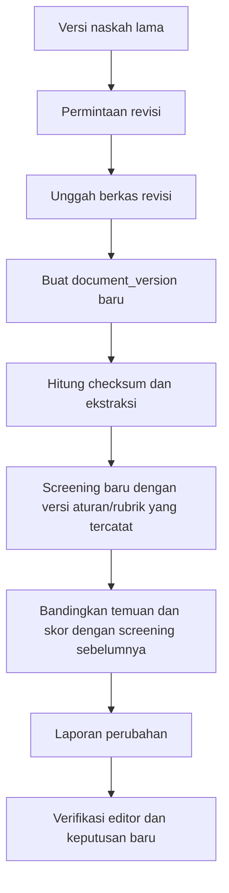
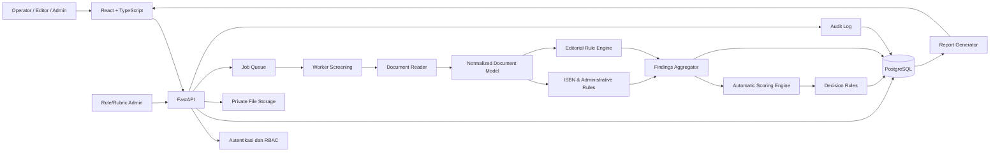
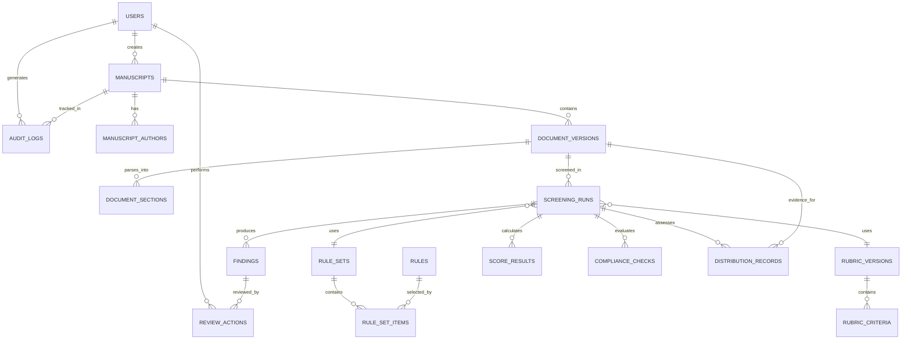

# Product Requirements Document (PRD)
## Sistem Screening Naskah Buku dan Penilaian Editorial Otomatis
**Organisasi:** PT Dimensi Antara Pustaka  
**Status dokumen:** Draft PRD untuk dasar desain, estimasi, dan pengembangan  
**Versi:** 1.0  
**Tanggal:** 23 Oktober 2026  
**Bahasa:** Indonesia

---

## 1. Ringkasan Produk

Sistem Screening Naskah Buku adalah aplikasi internal untuk menerima, membaca, memeriksa, menilai, dan melaporkan kesiapan naskah buku menggunakan **aturan yang eksplisit dan deterministik, tanpa model AI/LLM**.

Sistem menjalankan pemeriksaan teknis, kelengkapan, konsistensi struktur, rujukan, format, dan indikator editorial yang dapat diuji secara otomatis. Setiap temuan harus menunjuk lokasi yang dapat ditelusuri di dalam naskah serta menjelaskan alasan dan tindakan perbaikannya.

Sistem memiliki dua jalur keputusan yang saling berhubungan tetapi tidak boleh dicampur:

1. **Pemeriksaan persyaratan ISBN/administrasi penerbitan** berdasarkan aturan resmi yang sudah diverifikasi dan kebijakan operasional penerbit.
2. **Penilaian editorial** berdasarkan rubrik internal yang berversi dan terukur.

Skor editorial tidak dapat menggantikan atau mengesampingkan persyaratan wajib ISBN. Editor tidak memasukkan skor manual. Sistem menghitung skor; editor bertugas memverifikasi temuan, menandai temuan yang salah, menambahkan catatan koreksi yang dapat diaudit, dan menetapkan keputusan akhir sesuai kewenangan.

> **Penting:** ambang skor, bobot rubrik, dan indikator editorial dalam dokumen ini adalah usulan kebijakan internal awal, bukan standar resmi Perpusnas. Aturan ISBN wajib ditinjau terhadap peraturan dan prosedur resmi yang berlaku pada saat implementasi. ISBN tidak dengan sendirinya menyatakan bahwa isi buku berkualitas atau bahwa seluruh hak penerbitan telah terpenuhi.

---

## 2. Latar Belakang dan Masalah

Screening manual dapat memakan waktu, menghasilkan keputusan yang tidak konsisten, serta menyulitkan penerbit melacak alasan penolakan atau revisi. Masalah yang hendak diselesaikan:

- Pemeriksaan naskah dan kelengkapan dokumen belum memiliki satu alur kerja yang konsisten.
- Temuan sering tidak menunjuk halaman, bagian, paragraf, atau kutipan yang tepat.
- Skor editorial berisiko berbeda antarpemeriksa apabila diberikan secara subjektif.
- Pemeriksaan kelayakan ISBN dapat tercampur dengan kualitas editorial.
- Perubahan aturan atau rubrik sulit ditelusuri jika tidak memiliki versi dan tanggal berlaku.
- Riwayat revisi, hasil screening, verifikasi editor, dan keputusan akhir perlu disimpan secara auditabel.
- Sistem harus memberi tahu jika teks tidak dapat diekstrak dengan benar, bukan menganggap kegagalan teknis sebagai kekurangan mutu naskah.

## 3. Tujuan Produk

### 3.1 Tujuan utama

1. Mengotomatisasi pemeriksaan naskah secara menyeluruh sejauh dapat dinilai dengan aturan deterministik.
2. Menghitung skor editorial secara otomatis berdasarkan rubrik yang dapat dikonfigurasi dan berversi.
3. Menandai temuan dengan lokasi yang spesifik dan rekomendasi tindakan yang jelas.
4. Memisahkan hasil pemeriksaan ISBN/administratif dari hasil editorial.
5. Memungkinkan editor memverifikasi, mengoreksi, atau menyanggah temuan tanpa memberi skor manual.
6. Menyediakan laporan hasil screening yang dapat diunduh dan digunakan dalam alur kerja penerbit.
7. Menyediakan jejak audit untuk aturan, perubahan naskah, proses screening, verifikasi, dan keputusan.

### 3.2 Bukan tujuan

- Menggunakan AI generatif, LLM, atau model machine learning untuk membaca, menilai, atau memutuskan naskah.
- Menjamin bahwa sebuah naskah pasti memperoleh ISBN.
- Menggantikan keputusan profesional editor pada aspek yang tidak dapat diukur dengan aturan eksplisit.
- Mengklaim bahwa sistem otomatis dapat menilai kebaruan gagasan, kedalaman argumen, validitas ilmiah, atau kualitas estetika secara andal tanpa metode evaluasi yang didefinisikan.
- Mengirim naskah ke Perpusnas atau pihak luar secara otomatis pada fase awal.
- Menggantikan pemeriksaan hak cipta, legalitas, dan keaslian yang membutuhkan bukti atau penilaian di luar dokumen.

## 4. Prinsip Produk

1. **No AI/ML:** aturan eksplisit, parser dokumen, regex, kamus, validasi struktur, dan algoritme deterministik.
2. **Reproducible:** versi naskah, versi aturan, versi rubrik, dan konfigurasi yang sama harus menghasilkan hasil yang sama.
3. **Traceable:** setiap temuan dan skor harus memiliki alasan, aturan sumber, serta bukti yang dapat ditelusuri.
4. **Separate gates:** kepatuhan ISBN, skor editorial, dan kelengkapan teknis adalah hasil yang berbeda.
5. **Fail safely:** jika parsing atau ekstraksi gagal, status screening menjadi tidak lengkap/perlu diproses ulang, bukan menghasilkan skor palsu.
6. **Editor verifies, system scores:** editor tidak mengisi nilai kriteria; sistem menghitung nilai berdasarkan bukti terukur.
7. **Version everything:** aturan dan rubrik yang sudah digunakan tidak boleh berubah diam-diam.
8. **Human accountability:** keputusan final dan tindakan koreksi manusia tercatat dengan identitas, waktu, dan alasan.
9. **Privacy by default:** naskah merupakan aset rahasia penerbit dan penulis.
10. **Configurable policy:** persyaratan resmi, kebijakan penerbit, dan indikator editorial diberi label sumber yang berbeda.

---

## 5. Pengguna dan Hak Akses

| Peran | Kebutuhan | Hak utama |
|---|---|---|
| Admin sistem | Mengelola pengguna, konfigurasi, keamanan | Pengaturan sistem, akses audit, manajemen akun |
| Admin aturan/editorial | Memelihara aturan dan rubrik | Membuat versi aturan/rubrik, menguji, menerbitkan versi baru |
| Editor/verifikator | Memeriksa temuan sistem | Melihat naskah, memverifikasi/menyanggah temuan, memberi catatan, meminta revisi, merekomendasikan keputusan |
| Manajer/editor-in-chief | Memutuskan hasil akhir | Menyetujui, menolak, mengembalikan untuk revisi, melihat laporan |
| Operator penerimaan naskah | Mengunggah dan melengkapi metadata | Membuat naskah, mengunggah versi, melengkapi data penerimaan |
| Auditor/pembaca laporan | Memeriksa jejak keputusan | Baca laporan dan audit sesuai ruang lingkup izin |

Hak akses harus mengikuti prinsip least privilege. Pengguna hanya boleh mengakses naskah dan data sesuai peran serta penugasannya.

---

## 6. Ruang Lingkup

### 6.1 Termasuk dalam MVP

- Login dan role-based access control.
- Pembuatan rekaman naskah dan metadata penerimaan.
- Unggah DOCX dan PDF; dukungan TXT dapat ditambahkan untuk pengujian.
- Penyimpanan berkas asli yang tidak dapat ditimpa, versi dokumen, checksum, dan status parsing.
- Ekstraksi teks, struktur bab/subbab, paragraf, tabel dasar, nomor halaman jika tersedia, serta metadata dokumen.
- Pemeriksaan kelengkapan naskah dan bagian penerbitan.
- Pemeriksaan aturan ISBN/administratif dengan status sumber aturan.
- Pemeriksaan editorial berbasis indikator yang dapat diukur.
- Skor otomatis dan penjelasan kontribusi tiap kriteria.
- Penanda lokasi temuan dan saran perbaikan.
- Verifikasi temuan oleh editor.
- Permintaan revisi dan unggah versi baru.
- Laporan PDF/HTML; ekspor CSV untuk temuan dan skor.
- Riwayat screening, audit log, dan konfigurasi aturan/rubrik berversi.
- Status “perlu verifikasi” untuk hal yang tidak dapat dipastikan oleh sistem.

### 6.2 Di luar MVP

- Pengajuan ISBN otomatis ke Perpusnas.
- Integrasi langsung ke sistem eksternal penerbit, toko buku, atau katalog nasional.
- Kolaborasi penyuntingan langsung di dalam dokumen.
- OCR produksi skala besar untuk semua jenis hasil pindai.
- Pemeriksaan plagiarisme lintas internet atau korpus berbayar.
- Penilaian semantik otomatis atas orisinalitas, kebaruan, kedalaman, dan validitas isi.
- Aplikasi mobile native.

---

## 7. Definisi Status dan Keputusan

Status berikut adalah status operasional aplikasi, bukan label resmi Perpusnas.

### 7.1 Status teknis screening

- `QUEUED`: menunggu proses.
- `PROCESSING`: sedang diekstrak/diperiksa.
- `COMPLETED`: semua pemeriksaan yang direncanakan selesai.
- `INCOMPLETE`: ekstraksi atau pemeriksaan penting gagal; hasil tidak boleh dianggap final.
- `FAILED`: proses gagal karena kesalahan sistem.
- `CANCELLED`: proses dihentikan oleh pengguna berwenang.

### 7.2 Status kepatuhan ISBN/administratif

- `PASS`: semua aturan wajib yang berlaku telah lulus berdasarkan bukti tersedia.
- `FAIL`: ada aturan wajib yang terbukti tidak terpenuhi.
- `NEEDS_VERIFICATION`: bukti tidak cukup atau membutuhkan verifikasi manusia.
- `NOT_APPLICABLE`: jalur ISBN tertentu tidak berlaku pada tipe terbitan tersebut.
- `INCOMPLETE`: pemeriksaan teknis belum lengkap.

### 7.3 Status editorial

- `PASS_RECOMMENDED`: memenuhi ambang skor dan tidak ada temuan kritis terbuka.
- `MINOR_REVISION`: skor berada pada rentang revisi ringan atau terdapat temuan minor yang harus ditangani.
- `MAJOR_REVISION`: skor berada pada rentang revisi besar atau terdapat temuan mayor.
- `SUBSTANTIAL_REWORK`: skor di bawah ambang minimum yang ditetapkan.
- `NEEDS_VERIFICATION`: bukti untuk menghitung satu atau lebih kriteria belum cukup.
- `NOT_SCORABLE`: naskah terlalu tidak lengkap atau gagal diproses untuk dinilai.

### 7.4 Keputusan akhir workflow

- `ACCEPTED_FOR_NEXT_STAGE`
- `REVISION_REQUIRED`
- `REJECTED`
- `PENDING_VERIFICATION`
- `SCREENING_INCOMPLETE`

Keputusan akhir dibuat oleh peran berwenang setelah membaca hasil sistem dan verifikasi editor. Sistem boleh memberi rekomendasi, tetapi keputusan final harus tercatat sebagai tindakan pengguna yang memiliki izin.

---

## 8. Alur Kerja Utama

1. Operator membuat rekaman naskah dan melengkapi metadata dasar.
2. Operator mengunggah berkas; sistem menyimpan berkas asli, membuat checksum, dan membuat versi dokumen.
3. Document Reader mengekstrak teks serta struktur. Sistem menilai kualitas ekstraksi.
4. Jika ekstraksi gagal atau terlalu tidak lengkap, screening berhenti dengan `INCOMPLETE` atau `NOT_SCORABLE`.
5. Jika ekstraksi cukup, sistem menjalankan:
   - pemeriksaan kelengkapan dan klasifikasi naskah;
   - pemeriksaan ISBN/administratif;
   - pemeriksaan editorial;
   - pencarian lokasi temuan;
   - perhitungan skor otomatis.
6. Sistem menggabungkan hasil dan menerapkan aturan kritis. Kegagalan aturan wajib tidak dapat dikompensasi oleh skor editorial tinggi.
7. Sistem menghasilkan laporan awal dan daftar verifikasi editor.
8. Editor memverifikasi temuan: terkonfirmasi, tidak relevan/salah, atau membutuhkan pemeriksaan lanjutan. Editor tidak mengubah skor secara langsung.
9. Jika temuan dikoreksi, sistem menyimpan tindakan verifikasi dan menghitung ulang hasil turunan yang terdampak menggunakan aturan/rubrik yang sama.
10. Manajer/editor-in-chief menetapkan keputusan akhir.
11. Jika revisi diperlukan, operator mengunggah versi baru. Versi lama dan hasil screening sebelumnya tetap tersimpan.
12. Sistem menjalankan screening ulang terhadap versi baru dan mencatat perbandingan hasil.

### 8.1 Flowchart end-to-end



### 8.2 Flowchart mesin keputusan



### 8.3 Flowchart pembaruan versi



---

## 9. Persyaratan Fungsional

Prioritas: `P0` wajib untuk MVP, `P1` penting setelah MVP, `P2` lanjutan.

### FR-01 — Autentikasi dan otorisasi (P0)

- Pengguna dapat login/logout.
- Sistem mendukung peran dan izin.
- Semua endpoint sensitif memeriksa izin di backend.
- Akses dan perubahan penting dicatat pada audit log.

**Kriteria penerimaan**
- Pengguna tanpa izin tidak dapat membuka naskah, mengubah aturan, atau memutuskan hasil.
- Penolakan akses menghasilkan respons yang sesuai dan tercatat jika diperlukan.

### FR-02 — Penerimaan naskah (P0)

- Buat rekaman dengan judul kerja, penulis, jenis naskah, bahasa, tanggal masuk, operator, dan status.
- Dukung lebih dari satu penulis.
- Dukung pengunggahan DOCX/PDF sesuai batas ukuran konfigurasi.
- Validasi ekstensi, MIME type, ukuran, dan keamanan file.
- Simpan berkas asli secara immutable dengan checksum SHA-256.

**Kriteria penerimaan**
- Berkas tidak dapat diam-diam diganti pada versi yang sama.
- Pengunggahan ulang menciptakan versi baru.
- Metadata wajib yang belum lengkap ditandai, bukan diisi dengan asumsi.

### FR-03 — Pembaca dokumen (P0)

- Ekstrak teks dan struktur dokumen.
- Catat urutan halaman bila dapat diperoleh.
- Identifikasi heading, paragraf, daftar, tabel sederhana, catatan kaki, kutipan, dan bagian referensi sejauh didukung format.
- Catat metode ekstraksi dan peringatan kualitas.
- Simpan teks terstruktur yang terhubung ke versi dokumen.

**Kriteria penerimaan**
- Sistem menunjukkan peringatan jika PDF hasil pindai tidak memiliki teks yang dapat diekstrak.
- Jika OCR belum tersedia, sistem meminta DOCX/PDF teks atau menandai proses tidak lengkap.
- Temuan menyimpan locator yang paling spesifik dan tersedia.

### FR-04 — Klasifikasi naskah dan jalur aturan (P0)

- Tipe naskah dipilih operator dan dapat dikonfirmasi melalui metadata.
- Jenis yang mungkin: buku ilmiah, buku ajar, referensi, monograf, buku umum/nonfiksi, fiksi, terjemahan, kompilasi, atau kategori lain yang dikonfigurasi.
- Jalur aturan yang tidak relevan ditandai `NOT_APPLICABLE`, bukan dianggap gagal.

### FR-05 — Mesin aturan ISBN/administratif (P0)

- Jalankan aturan resmi yang sudah diverifikasi terhadap jenis terbitan dan konteks yang sesuai.
- Setiap aturan memiliki sumber, rujukan pasal/ketentuan, tanggal efektif, tanggal berakhir opsional, dan status verifikasi.
- Bedakan `official_regulation`, `official_procedure`, `publisher_policy`, dan `editorial_indicator`.
- Sistem memeriksa kelengkapan data/bukti yang memang dapat diperiksa otomatis.
- Hal yang memerlukan penilaian bukti, seperti status distribusi publik atau hak penerbitan, dapat menghasilkan `NEEDS_VERIFICATION`.
- Sistem tidak boleh menyatakan ISBN pasti diterima hanya berdasarkan skor editorial.

**Kriteria penerimaan**
- Aturan tanpa sumber atau tanpa status verifikasi tidak boleh diberi label sebagai persyaratan resmi yang aktif.
- Aturan wajib yang gagal menghalangi rekomendasi lulus pada jalur yang relevan.
- Status dan versi aturan tercatat pada setiap screening.

### FR-06 — Mesin aturan editorial (P0)

- Memeriksa indikator eksplisit seperti kelengkapan bagian, konsistensi struktur, penggunaan heading, keberadaan daftar pustaka, konsistensi pola sitasi yang didukung, metadata, dan indikator bahasa yang berbasis kamus/aturan.
- Setiap aturan memiliki kategori, tingkat keparahan, bukti, dan tindakan yang disarankan.
- Aturan dapat diaktifkan/dinonaktifkan melalui versi baru, bukan mengubah hasil historis.

**Kriteria penerimaan**
- Setiap temuan menyertakan rule ID dan bukti.
- Sistem tidak membuat klaim semantik yang tidak dapat didukung aturan.
- Temuan yang membutuhkan penilaian manusia diberi label `requires_human_verification`.

### FR-07 — Penilaian editorial otomatis (P0)

- Skor dihitung oleh sistem berdasarkan hasil pemeriksaan dan rubrik yang aktif.
- Editor tidak mempunyai input untuk menulis skor manual.
- Sistem menampilkan skor total, skor tiap kriteria, bobot, bukti, aturan yang memengaruhi skor, dan alasan skor tidak dapat dihitung.
- Rubrik dan ambang keputusan berversi.
- Temuan kritis dapat membatasi rekomendasi terlepas dari nilai numerik.

**Kriteria penerimaan**
- Input yang sama dengan versi aturan/rubrik yang sama menghasilkan skor yang sama.
- Tidak ada endpoint UI/API untuk mengubah skor langsung oleh editor.
- Perubahan hasil verifikasi harus menghasilkan rekalkulasi terkontrol dan jejak audit.

### FR-08 — Peta revisi (P0)

- Tampilkan daftar temuan yang dapat difilter menurut bab, halaman, kategori, keparahan, dan status.
- Tampilkan kutipan teks yang memicu temuan.
- Sediakan locator: versi dokumen, halaman, section path, paragraph ID, dan offset teks bila tersedia.
- Berikan tindakan perbaikan yang spesifik.

**Kriteria penerimaan**
- Temuan tidak hanya menyebut “periksa bab 2”; sistem harus menunjukkan lokasi yang tersedia dan menjelaskan alasannya.
- Jika nomor halaman tidak stabil atau tidak tersedia, sistem menampilkan section/paragraph locator dan menjelaskan keterbatasannya.

### FR-09 — Verifikasi editor (P0)

Status verifikasi temuan:
- `UNREVIEWED`
- `CONFIRMED`
- `FALSE_POSITIVE`
- `NEEDS_FURTHER_CHECK`
- `RESOLVED_IN_NEW_VERSION`

Editor dapat menambahkan catatan dan alasan. Editor tidak mengubah nilai skor secara langsung. Sistem menyimpan siapa, kapan, tindakan, dan nilai sebelum/sesudah.

### FR-10 — Revisi dan versi naskah (P0)

- Setiap revisi menjadi `document_version` baru.
- Screening baru merekam versi aturan/rubrik yang digunakan.
- Sistem membandingkan temuan baru, temuan yang hilang, temuan yang tetap ada, dan temuan baru.
- Hasil lama tetap dapat dilihat.

### FR-11 — Laporan (P0)

Laporan minimal memuat:
- Identitas naskah dan versi.
- Tanggal screening dan ID screening.
- Status teknis ekstraksi.
- Status ISBN/administratif per aturan.
- Skor editorial, bobot, indikator, dan status rekomendasi.
- Daftar temuan beserta lokasi, bukti, tingkat keparahan, saran, dan status verifikasi.
- Catatan verifikasi editor.
- Keputusan akhir dan penanggung jawab.
- Versi rule set dan rubrik.
- Disclaimer bahwa hasil sistem bukan jaminan penerimaan ISBN.

### FR-12 — Manajemen aturan dan rubrik (P0)

- Buat draft, uji, publikasikan, dan arsipkan versi aturan/rubrik.
- Versi yang sudah dipakai screening tidak dapat diedit secara in-place.
- Sediakan simulasi/test cases sebelum publikasi.
- Catat pemilik aturan, sumber, tanggal efektif, alasan perubahan, dan hasil pengujian.

### FR-13 — Audit dan histori (P0)

Catat peristiwa penting: unggah versi, perubahan metadata, screening dimulai/selesai, perubahan aturan/rubrik, verifikasi temuan, perubahan status, keputusan akhir, ekspor laporan, dan kegagalan sistem.

### FR-14 — OCR (P1)

- OCR hanya dijalankan jika diaktifkan dan ada alasan yang jelas.
- Hasil OCR menyimpan indikator kualitas dan peringatan.
- Hasil OCR berkualitas rendah tidak boleh menghasilkan keputusan final otomatis.

### FR-15 — Integrasi eksternal (P2)

Integrasi katalog, pengajuan ISBN, atau layanan pihak ketiga hanya setelah ada kajian API, otorisasi, keamanan, dan perubahan peraturan.

---

## 10. Kategori Pemeriksaan dan Aturan Awal

Aturan di bawah merupakan contoh awal untuk dipetakan menjadi aturan yang dapat dikonfigurasi. Ini bukan daftar lengkap persyaratan resmi ISBN.

### 10.1 Teknis dan kelengkapan berkas

- Berkas dapat dibaca dan tidak rusak.
- Tipe berkas dan ukuran diizinkan.
- Naskah tidak kosong dan ekstraksi melewati ambang minimum.
- Ada halaman judul atau metadata judul yang memadai.
- Bagian awal, daftar isi, isi utama, dan bagian akhir diperiksa keberadaannya sesuai tipe naskah.
- Jumlah halaman/karakter berada pada rentang kebijakan internal jika kebijakan tersebut ditetapkan.
- Tidak ada placeholder yang diketahui, seperti `[JUDUL DI SINI]`, `TODO`, atau `Lorem ipsum`, kecuali diizinkan.

### 10.2 Struktur dan konsistensi

- Urutan bab/subbab konsisten.
- Heading tidak melompat secara tidak wajar menurut konfigurasi.
- Nomor bab dan subbab mengikuti pola yang dipilih.
- Daftar isi dibandingkan dengan heading yang diekstrak bila format memungkinkan.
- Bagian yang diwajibkan oleh tipe buku tersedia.
- Bagian kosong atau bab yang terlalu pendek ditandai sebagai indikator, bukan otomatis dianggap gagal tanpa kebijakan eksplisit.

### 10.3 Sitasi dan referensi

- Pola sitasi yang dikenali dibandingkan dengan daftar referensi.
- Referensi yang tampak tidak pernah disitir dapat ditandai untuk pemeriksaan.
- Sitasi yang tidak memiliki pasangan referensi dapat ditandai.
- Konsistensi format referensi diperiksa hanya untuk gaya yang didukung.
- Sistem tidak boleh mengklaim bahwa sumber benar-benar ada atau valid hanya dari bentuk formatnya.

### 10.4 Bahasa dan teknis penulisan

- Ejaan/istilah dapat diperiksa dengan kamus atau aturan bahasa yang dipasang.
- Spasi ganda, tanda baca berulang, baris kosong berlebih, dan pola karakter tidak lazim dapat ditandai.
- Konsistensi istilah dapat diperiksa menggunakan daftar istilah yang dikelola.
- Indikator keterbacaan boleh disediakan sebagai metrik tambahan, tetapi tidak disamakan dengan kualitas isi.

### 10.5 Pengulangan dan keutuhan

- Paragraf identik atau sangat mirip dalam dokumen yang sama dapat ditandai dengan hash atau algoritme kemiripan deterministik.
- Pengulangan umum yang wajar (misalnya judul, istilah, daftar, atau kutipan) harus dikecualikan atau diberi prioritas rendah.
- Sistem tidak boleh menyimpulkan plagiarisme eksternal tanpa korpus pembanding dan metode yang sesuai.

### 10.6 ISBN dan administrasi penerbitan

Aturan harus mengacu pada peraturan/prosedur resmi yang aktif serta bukti yang relevan. Area pemeriksaan yang mungkin meliputi:
- Tipe terbitan dan jalur pengajuan yang relevan.
- Kelengkapan halaman awal atau materi yang dipersyaratkan dalam proses pengajuan.
- Kesesuaian metadata naskah dan data permohonan.
- Pernyataan orisinalitas atau dokumen hak yang relevan jika diperlukan.
- Izin terjemahan atau dokumen pengalihan hak jika berlaku.
- Bukti bahwa penerbit memiliki katalog dan kanal distribusi publik sesuai ketentuan yang berlaku.
- Indikasi bahwa naskah bersifat internal, terbatas, atau bukan terbitan untuk publik yang perlu ditinjau berdasarkan peraturan yang berlaku.

**Catatan kebijakan:** jangan mengunci aturan “harus dapat diperjualbelikan” sebagai aturan universal tanpa memeriksa rumusan resmi yang berlaku. Sistem sebaiknya menguji status penerbitan/distribusi publik berdasarkan ketentuan resmi dan menjadikan bukti yang belum cukup sebagai `NEEDS_VERIFICATION`.

---

## 11. Rubrik dan Perhitungan Skor Editorial

### 11.1 Rubrik awal yang disarankan

Bobot berikut adalah contoh awal untuk naskah buku ilmiah/buku ajar. Rubrik untuk fiksi, buku anak, buku populer, atau tipe lain perlu dibuat tersendiri.

| Kriteria | Bobot awal | Indikator otomatis yang memungkinkan |
|---|---:|---|
| Kelengkapan struktur | 15% | Bagian wajib tersedia, isi tidak kosong, struktur dasar terbaca |
| Konsistensi bab dan heading | 10% | Penomoran, heading, dan daftar isi konsisten |
| Sitasi dan referensi | 15% | Pasangan sitasi/referensi dan pola format yang didukung |
| Format dan kerapian teknis | 10% | Pola spasi, heading, penomoran, placeholder, karakter anomali |
| Bahasa dan konsistensi istilah | 15% | Temuan kamus/aturan bahasa, ejaan dan istilah terdaftar |
| Pengulangan internal | 10% | Duplikasi paragraf/segmen dengan pengecualian yang dikonfigurasi |
| Kelengkapan elemen pembahasan | 15% | Keberadaan elemen yang didefinisikan khusus untuk tipe buku |
| Metadata dan elemen penerbitan | 10% | Judul, penulis, daftar isi, referensi, dan elemen lain sesuai tipe |

Total bobot harus 100%. Kriteria yang tidak berlaku dapat dikecualikan hanya jika aturan rubrik menjelaskan cara normalisasi bobot. Jangan diam-diam memberi nilai penuh untuk kriteria yang tidak dapat diperiksa.

### 11.2 Rumus

Untuk setiap kriteria \(i\), sistem menghitung nilai \(s_i\) dalam skala 0–100 berdasarkan aturan yang terukur. Bobot \(w_i\) dinyatakan dalam persen.

\[
S = \frac{\sum_{i=1}^{n} w_i s_i}{\sum_{i=1}^{n} w_i}
\]

Rumus di atas berlaku hanya untuk kriteria yang valid dan dapat dinilai, sesuai kebijakan rubrik. Sistem harus menampilkan cakupan penilaian, misalnya “7 dari 8 kriteria dapat dinilai”. Jika cakupan berada di bawah ambang minimum, skor total tidak diterbitkan dan status menjadi `NEEDS_VERIFICATION` atau `NOT_SCORABLE`.

### 11.3 Ambang contoh

| Skor | Rekomendasi awal |
|---:|---|
| 85–100 | Dapat direkomendasikan ke tahap berikutnya jika tidak ada temuan kritis terbuka |
| 70–84,99 | Revisi; tingkat revisi ditentukan oleh temuan dan keparahan |
| Di bawah 70 | Revisi substansial atau evaluasi ulang |
| Skor tidak valid/tidak cukup bukti | Tidak diberi skor final; perlu verifikasi atau pemrosesan ulang |

Ambang ini merupakan konfigurasi internal yang harus diuji menggunakan kumpulan naskah representatif. Nilai tinggi tidak membatalkan kegagalan aturan wajib.

### 11.4 Keparahan temuan

- `CRITICAL`: kegagalan yang menurut kebijakan memblokir proses atau berisiko hukum/administratif tinggi.
- `MAJOR`: masalah substansial yang harus diselesaikan sebelum lanjut.
- `MINOR`: masalah terbatas yang dapat diperbaiki tanpa mengubah struktur besar.
- `INFO`: saran atau catatan yang tidak mengurangi skor kecuali rubrik menyatakannya.

Setiap aturan harus menentukan secara eksplisit apakah temuannya memengaruhi skor, apakah bersifat blocking, dan apakah memerlukan verifikasi manusia.

### 11.5 Pencegahan skor yang menyesatkan

- Kegagalan ekstraksi bukan skor nol.
- Kriteria yang tidak dapat dinilai tidak otomatis diberi 100.
- Temuan false positive yang disetujui editor dapat dikeluarkan dari perhitungan sesuai kebijakan, dengan rekalkulasi tercatat.
- Perubahan skor selalu menyimpan versi rubrik, bukti, dan alasan rekalkulasi.
- Jangan menggunakan skor untuk mengklaim kualitas semantik yang tidak diukur oleh aturan.

---

## 12. Model Temuan (Finding)

Setiap temuan minimal memiliki:

- `id`
- `screening_run_id`
- `document_version_id`
- `rule_id`
- `category`
- `severity`
- `title`
- `description`
- `evidence_excerpt`
- `page_number` bila tersedia
- `section_path`
- `paragraph_id`
- `char_start` dan `char_end` bila tersedia
- `suggested_action`
- `requires_human_verification`
- `verification_status`
- `created_at`

Temuan harus mempertahankan bukti asli yang memicu aturan. Jika teks diubah pada versi berikutnya, temuan lama tetap mengacu pada versi lama.

---

## 13. Arsitektur Teknis

### 13.1 Stack yang direkomendasikan

- **Backend API:** Python 3.12+ dan FastAPI.
- **Database:** PostgreSQL.
- **Frontend:** React + TypeScript.
- **Pembacaan DOCX:** `python-docx` dan/atau `lxml`.
- **Pembacaan PDF:** PyMuPDF.
- **Validasi skema:** Pydantic.
- **Pencocokan pola:** regex dan aturan deterministik.
- **Kamus bahasa:** kamus/daftar istilah yang dipasang dan dikelola.
- **Job queue (opsional tetapi disarankan untuk produksi):** Redis + Celery atau antrean kerja setara.
- **Penyimpanan file:** private object storage atau filesystem privat yang dibatasi aksesnya.
- **OCR (P1):** Tesseract atau layanan OCR yang disetujui; hasil OCR harus diberi indikator kualitas.
- **Laporan:** HTML/PDF dan CSV.

Tidak ada panggilan ke model AI/LLM dalam jalur screening. Library parser dan algoritme yang dipakai harus dicatat versinya.

### 13.2 Diagram arsitektur



### 13.3 Model dokumen ternormalisasi

Setelah ekstraksi, sistem membuat model internal dengan:
- versi dokumen;
- teks per halaman jika tersedia;
- section path;
- heading dan level;
- paragraf dan urutan;
- tabel/daftar jika didukung;
- metadata ekstraksi;
- locator ke teks sumber;
- peringatan dan kualitas ekstraksi.

Model ini menjadi input tunggal bagi mesin aturan sehingga hasil DOCX/PDF dapat diproses dengan cara konsisten.

---

## 14. Rancangan Database

### 14.1 Prinsip database

- Primary key menggunakan UUID.
- Semua waktu disimpan dalam UTC; UI menampilkan zona waktu yang sesuai.
- Gunakan foreign key, indeks, unique constraint, dan check constraint.
- Versi dokumen, screening, rule set, dan rubrik dipertahankan sebagai histori.
- File besar disimpan di storage privat; database menyimpan key/path internal, checksum, ukuran, MIME type, dan metadata.
- Hindari menyimpan token/password mentah. Password disimpan dalam bentuk hash menggunakan mekanisme autentikasi yang aman.
- Audit log tidak boleh mudah dimodifikasi oleh pengguna biasa.
- Data pribadi penulis dibatasi pada data yang diperlukan untuk operasional.

### 14.2 ERD (Entity Relationship Diagram)



### 14.3 Tabel inti

#### `users`
Menyimpan akun pengguna.

| Kolom | Tipe | Aturan |
|---|---|---|
| id | UUID | PK |
| full_name | VARCHAR(200) | NOT NULL |
| email | CITEXT/VARCHAR(320) | UNIQUE, NOT NULL |
| password_hash / identity_provider_id | VARCHAR | Sesuai mekanisme autentikasi |
| role | VARCHAR(40) | Validasi nilai peran |
| is_active | BOOLEAN | Default true |
| created_at | TIMESTAMPTZ | NOT NULL |
| updated_at | TIMESTAMPTZ | NOT NULL |

Jika pengguna dapat memiliki beberapa peran, ganti kolom `role` dengan tabel `roles` dan `user_roles`.

#### `manuscripts`
Satu rekaman untuk satu naskah yang masuk.

| Kolom | Tipe | Aturan |
|---|---|---|
| id | UUID | PK |
| internal_code | VARCHAR(50) | UNIQUE, NOT NULL |
| working_title | TEXT | NOT NULL |
| manuscript_type | VARCHAR(50) | NOT NULL |
| language_code | VARCHAR(10) | Mis. `id` |
| intake_status | VARCHAR(30) | Status penerimaan |
| submitted_at | TIMESTAMPTZ | Nullable |
| created_by | UUID | FK users |
| assigned_editor_id | UUID | FK users, nullable |
| metadata_json | JSONB | Metadata fleksibel tervalidasi |
| created_at | TIMESTAMPTZ | NOT NULL |
| updated_at | TIMESTAMPTZ | NOT NULL |

#### `manuscript_authors`
Relasi many-to-many antara naskah dan penulis.

| Kolom | Tipe | Aturan |
|---|---|---|
| id | UUID | PK |
| manuscript_id | UUID | FK manuscripts |
| author_name | VARCHAR(300) | NOT NULL |
| author_order | INTEGER | NOT NULL |
| author_email | VARCHAR(320) | Nullable, akses terbatas |
| affiliation | TEXT | Nullable |

Unique: `(manuscript_id, author_order)`.

#### `document_versions`
Satu baris untuk setiap berkas versi naskah.

| Kolom | Tipe | Aturan |
|---|---|---|
| id | UUID | PK |
| manuscript_id | UUID | FK manuscripts |
| version_number | INTEGER | NOT NULL |
| original_filename | TEXT | NOT NULL |
| storage_key | TEXT | NOT NULL |
| mime_type | VARCHAR(150) | NOT NULL |
| file_size_bytes | BIGINT | NOT NULL |
| sha256_checksum | CHAR(64) | NOT NULL |
| extraction_status | VARCHAR(30) | Status parsing |
| extraction_engine_version | VARCHAR(100) | Nullable |
| extraction_quality | NUMERIC(5,2) | Nullable, 0–100 |
| uploaded_by | UUID | FK users |
| uploaded_at | TIMESTAMPTZ | NOT NULL |
| supersedes_version_id | UUID | FK document_versions, nullable |

Unique: `(manuscript_id, version_number)`. Berkas versi lama tidak ditimpa.

#### `document_sections`
Representasi struktur teks yang diekstrak.

| Kolom | Tipe | Aturan |
|---|---|---|
| id | UUID | PK |
| document_version_id | UUID | FK document_versions |
| parent_section_id | UUID | FK document_sections, nullable |
| section_type | VARCHAR(30) | heading, paragraph, table, list, etc. |
| section_path | TEXT | Jalur bab/subbab |
| heading_text | TEXT | Nullable |
| paragraph_index | INTEGER | Nullable |
| page_number | INTEGER | Nullable |
| text_content | TEXT | Teks hasil ekstraksi |
| char_start | BIGINT | Nullable |
| char_end | BIGINT | Nullable |
| locator_json | JSONB | Informasi locator tambahan |
| extraction_warnings | JSONB | Default `[]` |

Index disarankan pada `(document_version_id, page_number)` dan `(document_version_id, section_path)`.

#### `rule_sets`
Kumpulan aturan yang dipakai pada suatu screening.

| Kolom | Tipe | Aturan |
|---|---|---|
| id | UUID | PK |
| name | VARCHAR(200) | NOT NULL |
| version | INTEGER | NOT NULL |
| status | VARCHAR(20) | draft, published, archived |
| effective_from | DATE | Nullable |
| effective_to | DATE | Nullable |
| description | TEXT | Nullable |
| created_by | UUID | FK users |
| published_by | UUID | FK users, nullable |
| published_at | TIMESTAMPTZ | Nullable |
| change_notes | TEXT | Nullable |
| created_at | TIMESTAMPTZ | NOT NULL |

Unique: `(name, version)`.

#### `rules`
Definisi aturan individual.

| Kolom | Tipe | Aturan |
|---|---|---|
| id | UUID | PK |
| rule_code | VARCHAR(80) | UNIQUE, NOT NULL |
| title | VARCHAR(250) | NOT NULL |
| category | VARCHAR(50) | ISBN, structure, language, etc. |
| authority_type | VARCHAR(40) | official_regulation, official_procedure, publisher_policy, editorial_indicator |
| source_title | TEXT | Nullable |
| source_url | TEXT | Nullable |
| source_reference | TEXT | Pasal/bagian/ketentuan |
| effective_from | DATE | Nullable |
| effective_to | DATE | Nullable |
| engine_key | VARCHAR(100) | Nama implementasi rule handler |
| config_json | JSONB | Parameter yang tervalidasi |
| severity | VARCHAR(20) | critical, major, minor, info |
| blocking | BOOLEAN | Default false |
| requires_human_verification | BOOLEAN | Default false |
| scoring_effect | JSONB | Parameter dampak skor |
| status | VARCHAR(20) | draft, active, retired |
| created_by | UUID | FK users |
| created_at | TIMESTAMPTZ | NOT NULL |

Aturan resmi harus memiliki referensi sumber dan status verifikasi sebelum dipublikasikan.

#### `rule_set_items`
Menghubungkan rule set versi tertentu dengan aturan dan konfigurasi yang digunakan.

| Kolom | Tipe | Aturan |
|---|---|---|
| id | UUID | PK |
| rule_set_id | UUID | FK rule_sets |
| rule_id | UUID | FK rules |
| enabled | BOOLEAN | NOT NULL |
| override_config_json | JSONB | Nullable |
| execution_order | INTEGER | NOT NULL |

Unique: `(rule_set_id, rule_id)`. Untuk reproducibility yang lebih kuat, simpan snapshot konfigurasi aturan pada versi rule set, bukan hanya referensi ke aturan yang mungkin berubah.

#### `rubric_versions`
Versi rubrik penilaian.

| Kolom | Tipe | Aturan |
|---|---|---|
| id | UUID | PK |
| name | VARCHAR(200) | NOT NULL |
| version | INTEGER | NOT NULL |
| manuscript_type | VARCHAR(50) | NOT NULL |
| status | VARCHAR(20) | draft, published, archived |
| min_scoring_coverage | NUMERIC(5,2) | Ambang cakupan penilaian |
| score_thresholds_json | JSONB | Ambang dan pemetaan status |
| created_by | UUID | FK users |
| published_by | UUID | FK users, nullable |
| published_at | TIMESTAMPTZ | Nullable |
| change_notes | TEXT | Nullable |

Unique: `(name, version, manuscript_type)`.

#### `rubric_criteria`
Kriteria yang membentuk satu rubrik versi.

| Kolom | Tipe | Aturan |
|---|---|---|
| id | UUID | PK |
| rubric_version_id | UUID | FK rubric_versions |
| criterion_code | VARCHAR(80) | NOT NULL |
| name | VARCHAR(200) | NOT NULL |
| description | TEXT | Nullable |
| weight_percent | NUMERIC(5,2) | NOT NULL |
| scoring_method_key | VARCHAR(100) | Handler deterministik |
| config_json | JSONB | Parameter pengukuran |
| required_for_scoring | BOOLEAN | Default true |
| min_evidence_coverage | NUMERIC(5,2) | Nullable |

Validasi publikasi: bobot total harus 100% atau sesuai kebijakan normalisasi eksplisit.

#### `screening_runs`
Satu eksekusi screening untuk satu versi naskah.

| Kolom | Tipe | Aturan |
|---|---|---|
| id | UUID | PK |
| manuscript_id | UUID | FK manuscripts |
| document_version_id | UUID | FK document_versions |
| rule_set_id | UUID | FK rule_sets |
| rubric_version_id | UUID | FK rubric_versions, nullable |
| run_number | INTEGER | NOT NULL |
| status | VARCHAR(30) | Status teknis |
| isbn_status | VARCHAR(30) | Status kepatuhan |
| editorial_status | VARCHAR(30) | Status editorial |
| final_decision | VARCHAR(40) | Nullable |
| started_at | TIMESTAMPTZ | Nullable |
| completed_at | TIMESTAMPTZ | Nullable |
| initiated_by | UUID | FK users |
| engine_version | VARCHAR(100) | NOT NULL |
| extraction_summary_json | JSONB | Ringkasan kualitas parsing |
| result_summary_json | JSONB | Ringkasan hasil |
| error_details | JSONB | Nullable |

Unique yang disarankan: `(document_version_id, run_number)`.

#### `findings`
Temuan individual yang dihasilkan screening.

| Kolom | Tipe | Aturan |
|---|---|---|
| id | UUID | PK |
| screening_run_id | UUID | FK screening_runs |
| document_version_id | UUID | FK document_versions |
| rule_id | UUID | FK rules |
| category | VARCHAR(50) | NOT NULL |
| severity | VARCHAR(20) | NOT NULL |
| title | TEXT | NOT NULL |
| description | TEXT | NOT NULL |
| evidence_excerpt | TEXT | Nullable |
| page_number | INTEGER | Nullable |
| section_path | TEXT | Nullable |
| document_section_id | UUID | FK document_sections, nullable |
| paragraph_id | TEXT | Nullable |
| char_start | BIGINT | Nullable |
| char_end | BIGINT | Nullable |
| suggested_action | TEXT | Nullable |
| requires_human_verification | BOOLEAN | Default false |
| verification_status | VARCHAR(30) | Default UNREVIEWED |
| machine_result_json | JSONB | Bukti/hasil rule handler |
| created_at | TIMESTAMPTZ | NOT NULL |

#### `score_results`
Skor per kriteria dan skor agregat.

| Kolom | Tipe | Aturan |
|---|---|---|
| id | UUID | PK |
| screening_run_id | UUID | FK screening_runs |
| rubric_criterion_id | UUID | FK rubric_criteria, nullable untuk total |
| result_type | VARCHAR(20) | criterion atau total |
| raw_score | NUMERIC(6,2) | 0–100, nullable jika tidak dapat dinilai |
| weight_percent | NUMERIC(5,2) | Bobot yang digunakan |
| weighted_contribution | NUMERIC(8,4) | Nullable |
| scoring_status | VARCHAR(30) | scored, unscorable, needs_verification |
| evidence_coverage | NUMERIC(5,2) | Nullable |
| explanation | TEXT | Nullable |
| calculation_details_json | JSONB | Bukti dan perhitungan |
| created_at | TIMESTAMPTZ | NOT NULL |

Constraint: satu hasil per kriteria per screening, ditambah satu hasil total. Implementasi dapat menggunakan `criterion_code` snapshot agar hasil historis tidak berubah jika kriteria diedit.

#### `compliance_checks`
Hasil pemeriksaan aturan ISBN/administratif.

| Kolom | Tipe | Aturan |
|---|---|---|
| id | UUID | PK |
| screening_run_id | UUID | FK screening_runs |
| rule_id | UUID | FK rules |
| result_status | VARCHAR(30) | pass, fail, needs_verification, not_applicable, incomplete |
| evidence_json | JSONB | NOT NULL |
| explanation | TEXT | Nullable |
| verified_by | UUID | FK users, nullable |
| verified_at | TIMESTAMPTZ | Nullable |
| created_at | TIMESTAMPTZ | NOT NULL |

#### `distribution_records`
Bukti/keterangan terkait katalog atau distribusi publik yang diperiksa.

| Kolom | Tipe | Aturan |
|---|---|---|
| id | UUID | PK |
| manuscript_id | UUID | FK manuscripts |
| document_version_id | UUID | FK document_versions, nullable |
| distribution_type | VARCHAR(50) | katalog publik, kanal distribusi, internal, dll. |
| url | TEXT | Nullable |
| evidence_description | TEXT | Nullable |
| verification_status | VARCHAR(30) | pending, verified, rejected, not_applicable |
| verified_by | UUID | FK users, nullable |
| verified_at | TIMESTAMPTZ | Nullable |
| created_at | TIMESTAMPTZ | NOT NULL |

Data ini adalah bukti operasional. Aturan keputusan yang berlaku tetap harus ditentukan oleh sumber resmi/kebijakan yang diverifikasi.

#### `review_actions`
Riwayat tindakan editor terhadap temuan dan screening.

| Kolom | Tipe | Aturan |
|---|---|---|
| id | UUID | PK |
| finding_id | UUID | FK findings, nullable |
| screening_run_id | UUID | FK screening_runs |
| actor_user_id | UUID | FK users |
| action_type | VARCHAR(50) | confirm, false_positive, needs_check, decision, note, etc. |
| previous_status | VARCHAR(50) | Nullable |
| new_status | VARCHAR(50) | Nullable |
| comment | TEXT | Nullable |
| evidence_json | JSONB | Nullable |
| created_at | TIMESTAMPTZ | NOT NULL |

#### `audit_logs`
Log audit untuk peristiwa penting.

| Kolom | Tipe | Aturan |
|---|---|---|
| id | UUID | PK |
| actor_user_id | UUID | FK users, nullable untuk sistem |
| manuscript_id | UUID | FK manuscripts, nullable |
| screening_run_id | UUID | FK screening_runs, nullable |
| event_type | VARCHAR(100) | NOT NULL |
| entity_type | VARCHAR(100) | NOT NULL |
| entity_id | UUID | Nullable |
| before_json | JSONB | Nullable |
| after_json | JSONB | Nullable |
| ip_address | INET | Opsional sesuai kebijakan privasi |
| user_agent | TEXT | Opsional |
| created_at | TIMESTAMPTZ | NOT NULL |

Audit log harus append-only bagi aplikasi biasa. Akses pembacaan audit log juga dapat diaudit.

### 14.4 Relasi dan constraint penting

- Satu `manuscript` memiliki banyak `document_versions`.
- Satu `document_version` dapat memiliki banyak `screening_runs`.
- Satu `screening_run` harus merekam versi rule set dan rubrik yang digunakan.
- Satu `screening_run` menghasilkan banyak `findings`, `score_results`, dan `compliance_checks`.
- Temuan selalu terikat ke versi dokumen, tidak hanya ke naskah umum.
- Versi aturan/rubrik yang telah dipublikasikan tidak boleh diubah secara in-place.
- `screening_runs` yang sudah selesai bersifat historis; rekalkulasi membuat hasil revisi/eksekusi baru atau revisi hasil yang tercatat secara eksplisit.
- Gunakan soft delete untuk data operasional bila diperlukan; jangan menghapus histori audit yang wajib dipertahankan.
- Tetapkan kebijakan retensi dan penghapusan sesuai kontrak penulis, hukum, dan kebijakan keamanan.

### 14.5 Indeks database yang disarankan

- `manuscripts(internal_code)` unique.
- `document_versions(manuscript_id, version_number)` unique.
- `screening_runs(document_version_id, run_number)` unique.
- `findings(screening_run_id, severity, verification_status)`.
- `findings(document_version_id, page_number)`.
- `compliance_checks(screening_run_id, result_status)`.
- `audit_logs(manuscript_id, created_at)`.
- `audit_logs(actor_user_id, created_at)`.
- `document_sections(document_version_id, section_path)`.
- `screening_runs(status, started_at)` untuk antrean/pemantauan.

### 14.6 SQL DDL awal (PostgreSQL)

DDL berikut adalah fondasi implementasi, bukan migrasi produksi final. Enum/status dan validasi JSON perlu disesuaikan dengan desain backend dan strategi migrasi.

```sql
CREATE EXTENSION IF NOT EXISTS pgcrypto;
CREATE EXTENSION IF NOT EXISTS citext;

CREATE TABLE users (
    id UUID PRIMARY KEY DEFAULT gen_random_uuid(),
    full_name VARCHAR(200) NOT NULL,
    email CITEXT NOT NULL UNIQUE,
    password_hash TEXT,
    role VARCHAR(40) NOT NULL,
    is_active BOOLEAN NOT NULL DEFAULT TRUE,
    created_at TIMESTAMPTZ NOT NULL DEFAULT now(),
    updated_at TIMESTAMPTZ NOT NULL DEFAULT now()
);

CREATE TABLE manuscripts (
    id UUID PRIMARY KEY DEFAULT gen_random_uuid(),
    internal_code VARCHAR(50) NOT NULL UNIQUE,
    working_title TEXT NOT NULL,
    manuscript_type VARCHAR(50) NOT NULL,
    language_code VARCHAR(10) NOT NULL DEFAULT 'id',
    intake_status VARCHAR(30) NOT NULL DEFAULT 'RECEIVED',
    submitted_at TIMESTAMPTZ,
    created_by UUID NOT NULL REFERENCES users(id),
    assigned_editor_id UUID REFERENCES users(id),
    metadata_json JSONB NOT NULL DEFAULT '{}'::jsonb,
    created_at TIMESTAMPTZ NOT NULL DEFAULT now(),
    updated_at TIMESTAMPTZ NOT NULL DEFAULT now()
);

CREATE TABLE manuscript_authors (
    id UUID PRIMARY KEY DEFAULT gen_random_uuid(),
    manuscript_id UUID NOT NULL REFERENCES manuscripts(id),
    author_name VARCHAR(300) NOT NULL,
    author_order INTEGER NOT NULL CHECK (author_order > 0),
    author_email VARCHAR(320),
    affiliation TEXT,
    UNIQUE (manuscript_id, author_order)
);

CREATE TABLE document_versions (
    id UUID PRIMARY KEY DEFAULT gen_random_uuid(),
    manuscript_id UUID NOT NULL REFERENCES manuscripts(id),
    version_number INTEGER NOT NULL CHECK (version_number > 0),
    original_filename TEXT NOT NULL,
    storage_key TEXT NOT NULL,
    mime_type VARCHAR(150) NOT NULL,
    file_size_bytes BIGINT NOT NULL CHECK (file_size_bytes > 0),
    sha256_checksum CHAR(64) NOT NULL,
    extraction_status VARCHAR(30) NOT NULL DEFAULT 'PENDING',
    extraction_engine_version VARCHAR(100),
    extraction_quality NUMERIC(5,2) CHECK (extraction_quality BETWEEN 0 AND 100),
    uploaded_by UUID NOT NULL REFERENCES users(id),
    uploaded_at TIMESTAMPTZ NOT NULL DEFAULT now(),
    supersedes_version_id UUID REFERENCES document_versions(id),
    UNIQUE (manuscript_id, version_number)
);

CREATE TABLE document_sections (
    id UUID PRIMARY KEY DEFAULT gen_random_uuid(),
    document_version_id UUID NOT NULL REFERENCES document_versions(id),
    parent_section_id UUID REFERENCES document_sections(id),
    section_type VARCHAR(30) NOT NULL,
    section_path TEXT,
    heading_text TEXT,
    paragraph_index INTEGER,
    page_number INTEGER,
    text_content TEXT,
    char_start BIGINT,
    char_end BIGINT,
    locator_json JSONB NOT NULL DEFAULT '{}'::jsonb,
    extraction_warnings JSONB NOT NULL DEFAULT '[]'::jsonb
);

CREATE TABLE rule_sets (
    id UUID PRIMARY KEY DEFAULT gen_random_uuid(),
    name VARCHAR(200) NOT NULL,
    version INTEGER NOT NULL CHECK (version > 0),
    status VARCHAR(20) NOT NULL CHECK (status IN ('draft','published','archived')),
    effective_from DATE,
    effective_to DATE,
    description TEXT,
    created_by UUID NOT NULL REFERENCES users(id),
    published_by UUID REFERENCES users(id),
    published_at TIMESTAMPTZ,
    change_notes TEXT,
    created_at TIMESTAMPTZ NOT NULL DEFAULT now(),
    UNIQUE (name, version),
    CHECK (effective_to IS NULL OR effective_from IS NULL OR effective_to >= effective_from)
);

CREATE TABLE rules (
    id UUID PRIMARY KEY DEFAULT gen_random_uuid(),
    rule_code VARCHAR(80) NOT NULL UNIQUE,
    title VARCHAR(250) NOT NULL,
    category VARCHAR(50) NOT NULL,
    authority_type VARCHAR(40) NOT NULL CHECK (
        authority_type IN (
            'official_regulation','official_procedure',
            'publisher_policy','editorial_indicator'
        )
    ),
    source_title TEXT,
    source_url TEXT,
    source_reference TEXT,
    effective_from DATE,
    effective_to DATE,
    engine_key VARCHAR(100) NOT NULL,
    config_json JSONB NOT NULL DEFAULT '{}'::jsonb,
    severity VARCHAR(20) NOT NULL CHECK (severity IN ('critical','major','minor','info')),
    blocking BOOLEAN NOT NULL DEFAULT FALSE,
    requires_human_verification BOOLEAN NOT NULL DEFAULT FALSE,
    scoring_effect JSONB NOT NULL DEFAULT '{}'::jsonb,
    status VARCHAR(20) NOT NULL DEFAULT 'draft'
        CHECK (status IN ('draft','active','retired')),
    created_by UUID NOT NULL REFERENCES users(id),
    created_at TIMESTAMPTZ NOT NULL DEFAULT now()
);

CREATE TABLE rule_set_items (
    id UUID PRIMARY KEY DEFAULT gen_random_uuid(),
    rule_set_id UUID NOT NULL REFERENCES rule_sets(id),
    rule_id UUID NOT NULL REFERENCES rules(id),
    enabled BOOLEAN NOT NULL DEFAULT TRUE,
    override_config_json JSONB,
    execution_order INTEGER NOT NULL DEFAULT 100,
    rule_snapshot_json JSONB NOT NULL DEFAULT '{}'::jsonb,
    UNIQUE (rule_set_id, rule_id)
);

CREATE TABLE rubric_versions (
    id UUID PRIMARY KEY DEFAULT gen_random_uuid(),
    name VARCHAR(200) NOT NULL,
    version INTEGER NOT NULL CHECK (version > 0),
    manuscript_type VARCHAR(50) NOT NULL,
    status VARCHAR(20) NOT NULL CHECK (status IN ('draft','published','archived')),
    min_scoring_coverage NUMERIC(5,2) NOT NULL DEFAULT 80
        CHECK (min_scoring_coverage BETWEEN 0 AND 100),
    score_thresholds_json JSONB NOT NULL DEFAULT '{}'::jsonb,
    created_by UUID NOT NULL REFERENCES users(id),
    published_by UUID REFERENCES users(id),
    published_at TIMESTAMPTZ,
    change_notes TEXT,
    created_at TIMESTAMPTZ NOT NULL DEFAULT now(),
    UNIQUE (name, version, manuscript_type)
);

CREATE TABLE rubric_criteria (
    id UUID PRIMARY KEY DEFAULT gen_random_uuid(),
    rubric_version_id UUID NOT NULL REFERENCES rubric_versions(id),
    criterion_code VARCHAR(80) NOT NULL,
    name VARCHAR(200) NOT NULL,
    description TEXT,
    weight_percent NUMERIC(5,2) NOT NULL CHECK (weight_percent >= 0 AND weight_percent <= 100),
    scoring_method_key VARCHAR(100) NOT NULL,
    config_json JSONB NOT NULL DEFAULT '{}'::jsonb,
    required_for_scoring BOOLEAN NOT NULL DEFAULT TRUE,
    min_evidence_coverage NUMERIC(5,2),
    UNIQUE (rubric_version_id, criterion_code)
);

CREATE TABLE screening_runs (
    id UUID PRIMARY KEY DEFAULT gen_random_uuid(),
    manuscript_id UUID NOT NULL REFERENCES manuscripts(id),
    document_version_id UUID NOT NULL REFERENCES document_versions(id),
    rule_set_id UUID NOT NULL REFERENCES rule_sets(id),
    rubric_version_id UUID REFERENCES rubric_versions(id),
    run_number INTEGER NOT NULL CHECK (run_number > 0),
    status VARCHAR(30) NOT NULL DEFAULT 'QUEUED',
    isbn_status VARCHAR(30),
    editorial_status VARCHAR(30),
    final_decision VARCHAR(40),
    started_at TIMESTAMPTZ,
    completed_at TIMESTAMPTZ,
    initiated_by UUID NOT NULL REFERENCES users(id),
    engine_version VARCHAR(100) NOT NULL,
    extraction_summary_json JSONB NOT NULL DEFAULT '{}'::jsonb,
    result_summary_json JSONB NOT NULL DEFAULT '{}'::jsonb,
    error_details JSONB,
    UNIQUE (document_version_id, run_number)
);

CREATE TABLE findings (
    id UUID PRIMARY KEY DEFAULT gen_random_uuid(),
    screening_run_id UUID NOT NULL REFERENCES screening_runs(id),
    document_version_id UUID NOT NULL REFERENCES document_versions(id),
    rule_id UUID NOT NULL REFERENCES rules(id),
    category VARCHAR(50) NOT NULL,
    severity VARCHAR(20) NOT NULL CHECK (severity IN ('critical','major','minor','info')),
    title TEXT NOT NULL,
    description TEXT NOT NULL,
    evidence_excerpt TEXT,
    page_number INTEGER,
    section_path TEXT,
    document_section_id UUID REFERENCES document_sections(id),
    paragraph_id TEXT,
    char_start BIGINT,
    char_end BIGINT,
    suggested_action TEXT,
    requires_human_verification BOOLEAN NOT NULL DEFAULT FALSE,
    verification_status VARCHAR(30) NOT NULL DEFAULT 'UNREVIEWED',
    machine_result_json JSONB NOT NULL DEFAULT '{}'::jsonb,
    created_at TIMESTAMPTZ NOT NULL DEFAULT now(),
    CHECK (char_end IS NULL OR char_start IS NULL OR char_end >= char_start)
);

CREATE TABLE score_results (
    id UUID PRIMARY KEY DEFAULT gen_random_uuid(),
    screening_run_id UUID NOT NULL REFERENCES screening_runs(id),
    rubric_criterion_id UUID REFERENCES rubric_criteria(id),
    criterion_code_snapshot VARCHAR(80),
    result_type VARCHAR(20) NOT NULL CHECK (result_type IN ('criterion','total')),
    raw_score NUMERIC(6,2) CHECK (raw_score BETWEEN 0 AND 100),
    weight_percent NUMERIC(5,2) NOT NULL DEFAULT 0,
    weighted_contribution NUMERIC(8,4),
    scoring_status VARCHAR(30) NOT NULL,
    evidence_coverage NUMERIC(5,2) CHECK (evidence_coverage BETWEEN 0 AND 100),
    explanation TEXT,
    calculation_details_json JSONB NOT NULL DEFAULT '{}'::jsonb,
    created_at TIMESTAMPTZ NOT NULL DEFAULT now()
);

CREATE TABLE compliance_checks (
    id UUID PRIMARY KEY DEFAULT gen_random_uuid(),
    screening_run_id UUID NOT NULL REFERENCES screening_runs(id),
    rule_id UUID NOT NULL REFERENCES rules(id),
    result_status VARCHAR(30) NOT NULL CHECK (
        result_status IN ('pass','fail','needs_verification','not_applicable','incomplete')
    ),
    evidence_json JSONB NOT NULL DEFAULT '{}'::jsonb,
    explanation TEXT,
    verified_by UUID REFERENCES users(id),
    verified_at TIMESTAMPTZ,
    created_at TIMESTAMPTZ NOT NULL DEFAULT now(),
    UNIQUE (screening_run_id, rule_id)
);

CREATE TABLE distribution_records (
    id UUID PRIMARY KEY DEFAULT gen_random_uuid(),
    manuscript_id UUID NOT NULL REFERENCES manuscripts(id),
    document_version_id UUID REFERENCES document_versions(id),
    distribution_type VARCHAR(50) NOT NULL,
    url TEXT,
    evidence_description TEXT,
    verification_status VARCHAR(30) NOT NULL DEFAULT 'pending',
    verified_by UUID REFERENCES users(id),
    verified_at TIMESTAMPTZ,
    created_at TIMESTAMPTZ NOT NULL DEFAULT now()
);

CREATE TABLE review_actions (
    id UUID PRIMARY KEY DEFAULT gen_random_uuid(),
    finding_id UUID REFERENCES findings(id),
    screening_run_id UUID NOT NULL REFERENCES screening_runs(id),
    actor_user_id UUID NOT NULL REFERENCES users(id),
    action_type VARCHAR(50) NOT NULL,
    previous_status VARCHAR(50),
    new_status VARCHAR(50),
    comment TEXT,
    evidence_json JSONB,
    created_at TIMESTAMPTZ NOT NULL DEFAULT now()
);

CREATE TABLE audit_logs (
    id UUID PRIMARY KEY DEFAULT gen_random_uuid(),
    actor_user_id UUID REFERENCES users(id),
    manuscript_id UUID REFERENCES manuscripts(id),
    screening_run_id UUID REFERENCES screening_runs(id),
    event_type VARCHAR(100) NOT NULL,
    entity_type VARCHAR(100) NOT NULL,
    entity_id UUID,
    before_json JSONB,
    after_json JSONB,
    ip_address INET,
    user_agent TEXT,
    created_at TIMESTAMPTZ NOT NULL DEFAULT now()
);

CREATE INDEX idx_document_sections_version_page
    ON document_sections(document_version_id, page_number);
CREATE INDEX idx_document_sections_version_path
    ON document_sections(document_version_id, section_path);
CREATE INDEX idx_screening_runs_status_started
    ON screening_runs(status, started_at);
CREATE INDEX idx_findings_run_severity_status
    ON findings(screening_run_id, severity, verification_status);
CREATE INDEX idx_findings_version_page
    ON findings(document_version_id, page_number);
CREATE INDEX idx_compliance_checks_run_status
    ON compliance_checks(screening_run_id, result_status);
CREATE INDEX idx_audit_logs_manuscript_time
    ON audit_logs(manuscript_id, created_at);
CREATE INDEX idx_audit_logs_actor_time
    ON audit_logs(actor_user_id, created_at);
```

**Catatan DDL:** aturan “total bobot rubrik = 100%” membutuhkan validasi lintas baris pada saat publikasi rubrik (misalnya dalam service layer atau trigger). Snapshot konfigurasi aturan dan rubrik harus disimpan agar hasil historis tidak bergantung pada perubahan definisi terbaru. Jika memakai SSO/identity provider, `password_hash` dapat dihilangkan.

---

## 15. Rancangan API

Prefix API: `/api/v1`.

| Method | Endpoint | Fungsi |
|---|---|---|
| POST | `/manuscripts` | Membuat rekaman naskah |
| GET | `/manuscripts` | Daftar naskah dengan filter/paginasi |
| GET | `/manuscripts/{id}` | Detail naskah |
| PATCH | `/manuscripts/{id}` | Mengubah metadata yang diizinkan |
| POST | `/manuscripts/{id}/versions` | Unggah versi baru |
| GET | `/manuscripts/{id}/versions` | Riwayat versi |
| GET | `/versions/{version_id}` | Detail versi dan status ekstraksi |
| POST | `/screenings` | Membuat screening run |
| GET | `/screenings/{id}` | Status dan ringkasan screening |
| GET | `/screenings/{id}/findings` | Temuan dengan filter |
| GET | `/screenings/{id}/scores` | Skor total dan per kriteria |
| GET | `/screenings/{id}/compliance` | Status aturan ISBN/administratif |
| GET | `/screenings/{id}/report` | Menghasilkan/mengunduh laporan |
| POST | `/findings/{id}/review-actions` | Memverifikasi atau memberi catatan temuan |
| POST | `/screenings/{id}/decision` | Mencatat keputusan oleh pengguna berwenang |
| POST | `/screenings/{id}/rerun` | Membuat screening ulang |
| GET | `/rules` | Daftar aturan |
| POST | `/rules` | Membuat aturan draft |
| PATCH | `/rules/{id}` | Mengubah aturan draft |
| POST | `/rule-sets` | Membuat versi kumpulan aturan |
| POST | `/rule-sets/{id}/publish` | Publikasi versi aturan setelah validasi |
| GET | `/rubrics` | Daftar rubrik |
| POST | `/rubrics` | Membuat versi rubrik draft |
| POST | `/rubrics/{id}/publish` | Publikasi rubrik setelah validasi |
| GET | `/audit-logs` | Pencarian audit sesuai izin |

### 15.1 Ketentuan API

- Gunakan validasi input dan output schema.
- Semua endpoint yang mengubah data membutuhkan autentikasi dan izin.
- Unggah file menggunakan multipart/form-data dan batas ukuran yang dikonfigurasi.
- Screening asinkron mengembalikan `screening_run_id` dan status awal.
- Gunakan idempotency key untuk operasi yang rawan dikirim ulang, bila sesuai.
- Jangan menyediakan endpoint untuk editor mengubah skor secara manual.
- Kesalahan parsing harus dikembalikan sebagai status terstruktur, bukan hanya pesan teks.
- Gunakan paginasi dan filter pada daftar temuan/audit.
- Jangan menampilkan `storage_key` internal kepada pengguna yang tidak berwenang.

### 15.2 Contoh respons pembuatan screening

```json
{
  "screening_run_id": "UUID",
  "status": "QUEUED",
  "message": "Screening dimasukkan ke antrean."
}
```

### 15.3 Contoh konfigurasi aturan

```json
{
  "rule_code": "REF-001",
  "title": "Sitasi tidak ditemukan dalam daftar referensi",
  "category": "citation_reference",
  "authority_type": "editorial_indicator",
  "engine_key": "citation_reference_match",
  "severity": "major",
  "blocking": false,
  "requires_human_verification": true,
  "config_json": {
    "citation_patterns": ["author_year", "numeric"],
    "ignore_common_false_positives": true
  },
  "scoring_effect": {
    "criterion_code": "citations_references",
    "deduction_per_finding": 5,
    "max_deduction": 30
  }
}
```

Contoh di atas hanya contoh konfigurasi teknis. Mesin aturan perlu memvalidasi konfigurasi sebelum aturan dapat diterbitkan.

---

## 16. Rancangan Antarmuka

### 16.1 Dashboard Screening

Menampilkan:
- jumlah naskah baru;
- sedang diproses;
- perlu verifikasi;
- revisi menunggu;
- screening gagal;
- filter berdasarkan editor, tipe naskah, status, dan tanggal.

### 16.2 Halaman Detail Naskah

Tab:
- Ringkasan;
- Metadata dan penulis;
- Versi berkas;
- Hasil screening;
- Temuan dan peta revisi;
- Skor editorial;
- Kepatuhan ISBN/administratif;
- Riwayat keputusan;
- Audit.

### 16.3 Document Viewer & Revision Map

- Panel teks/halaman jika viewer mendukung.
- Daftar temuan dengan warna/label berdasarkan tingkat keparahan.
- Klik temuan membuka lokasi yang tersedia.
- Filter status verifikasi, kategori, bab, dan halaman.
- Kutipan bukti dan tindakan perbaikan.
- Jika lokasi halaman tidak akurat akibat ekstraksi, tampilkan peringatan dan locator alternatif.

### 16.4 Editorial Scorecard

- Skor total dan status.
- Skor per kriteria.
- Bobot dan formula.
- Bukti yang memengaruhi skor.
- Cakupan penilaian.
- Daftar temuan kritis/mayor.
- Versi rubrik.
- Tidak ada field untuk mengedit skor secara manual.

### 16.5 Rule & Rubric Builder

- Editor aturan dengan kategori, sumber, keparahan, blocking, konfigurasi, dan status verifikasi sumber.
- Builder rubrik dengan bobot dan handler skor.
- Validasi total bobot.
- Draft/publish/archive.
- Test cases dan simulasi sebelum publish.
- Diff antarversi.

### 16.6 Report Center

- Preview laporan.
- Unduh PDF/HTML.
- Ekspor temuan/skor ke CSV.
- Identitas versi naskah dan versi aturan/rubrik wajib tercantum.

---

## 17. Persyaratan Nonfungsional

### 17.1 Kinerja

Target awal untuk MVP, perlu diuji pada infrastruktur nyata:
- Metadata dan halaman dashboard biasa: p95 di bawah 2 detik pada beban normal.
- Operasi daftar dengan paginasi: p95 di bawah 2 detik.
- Pemrosesan naskah dilakukan asinkron agar permintaan HTTP tidak menunggu parsing penuh.
- Target waktu screening ditetapkan berdasarkan panjang dokumen dan benchmark; jangan menjanjikan durasi sebelum pengujian.

### 17.2 Keandalan

- Pekerjaan yang gagal dapat dilacak dan dijalankan ulang dengan aman.
- Job screening memiliki status, waktu mulai/selesai, versi engine, dan detail kesalahan.
- Worker tidak membuat hasil duplikat saat retry.
- Backup database dan file diuji pemulihannya.

### 17.3 Keamanan dan privasi

- HTTPS untuk lalu lintas jaringan.
- Enkripsi penyimpanan dan backup sesuai kemampuan infrastruktur.
- File disimpan di lokasi privat, bukan direktori publik.
- Validasi tipe file berdasarkan isi, bukan hanya ekstensi.
- Pemindaian malware file unggahan bila tersedia.
- Pembatasan ukuran, rate limit, dan perlindungan terhadap file arsip berbahaya.
- Rahasia aplikasi disimpan melalui secret manager/environment yang aman.
- Akses file menggunakan izin dan URL sementara bila object storage digunakan.
- Data penulis dan naskah tidak boleh dipakai untuk tujuan lain tanpa dasar dan izin yang sesuai.
- Log tidak boleh mencatat isi naskah lengkap atau data sensitif yang tidak diperlukan.
- Tetapkan kebijakan retensi, penghapusan, ekspor, dan respons insiden.

### 17.4 Auditabilitas

- Semua hasil harus dapat ditelusuri ke versi dokumen, versi engine, rule set, rubrik, dan konfigurasi.
- Perubahan keputusan harus menyimpan nilai lama/baru dan aktor.
- Versi yang sudah selesai tidak boleh berubah tanpa peristiwa audit yang eksplisit.
- Gunakan waktu server yang konsisten.

### 17.5 Aksesibilitas dan kegunaan

- Bahasa UI Indonesia.
- Status tidak hanya dibedakan dengan warna; gunakan label teks.
- Filter dan navigasi keyboard untuk daftar temuan.
- Pesan error menyebut tindakan berikutnya secara jelas.

---

## 18. Logging, Monitoring, dan Operasional

Pantau:
- jumlah job antrean, sukses, gagal, dan durasi;
- rasio parsing gagal berdasarkan format;
- error handler aturan;
- perubahan versi aturan/rubrik;
- skor yang tidak dapat dihitung;
- jumlah false positive per aturan;
- ukuran penyimpanan dan status backup;
- akses yang ditolak dan aktivitas tidak biasa.

Sediakan dashboard operasional dan alert untuk:
- worker berhenti;
- antrean terlalu panjang;
- lonjakan kegagalan parsing;
- job gagal berulang;
- backup tidak berhasil;
- penggunaan storage mendekati batas.

---

## 19. Pengujian dan Validasi

### 19.1 Jenis pengujian

- Unit test untuk setiap rule handler dan scoring method.
- Integration test dari unggah sampai laporan.
- Regression test untuk memastikan perubahan aturan tidak mengubah hasil historis.
- Test dokumen DOCX/PDF normal, rusak, kosong, sangat panjang, mengandung tabel, catatan kaki, dan font/format tidak biasa.
- Test keamanan upload, izin akses, dan pemisahan data antarnaskah.
- Test retry job dan idempotensi.
- Uji pemulihan backup.
- Uji laporan terhadap hasil database.

### 19.2 Korpus validasi

Siapkan kumpulan naskah uji yang:
- mewakili tipe buku yang benar-benar diterima penerbit;
- berisi kasus lulus, revisi, tidak lengkap, dan perlu verifikasi;
- telah diperiksa oleh editor yang berwenang untuk membangun ground truth;
- tidak dipakai tanpa hak/izin yang sesuai;
- disamarkan bila diperlukan untuk pengujian.

### 19.3 Metrik

- Precision/recall per aturan, jika ground truth tersedia.
- Tingkat false positive per aturan.
- Tingkat parsing berhasil per format.
- Persentase temuan yang memiliki locator berguna.
- Persentase screening yang dapat diberi skor dengan cakupan yang memadai.
- Konsistensi skor untuk input dan konfigurasi identik.
- Waktu pemrosesan berdasarkan ukuran/kompleksitas naskah.
- Persentase temuan yang dikoreksi editor, untuk memprioritaskan perbaikan aturan.

Jangan menggunakan satu angka akurasi global untuk menutupi performa aturan yang berbeda-beda.

---

## 20. Kriteria Penerimaan MVP

MVP dianggap siap untuk uji operasional ketika:

1. Pengguna berwenang dapat membuat rekaman naskah dan mengunggah versi DOCX/PDF.
2. Berkas asli, checksum, dan nomor versi tersimpan; berkas lama tidak tertimpa.
3. Sistem mengekstrak struktur yang didukung dan menandai kegagalan ekstraksi secara eksplisit.
4. Screening menyimpan versi engine, rule set, dan rubrik yang digunakan.
5. Pemeriksaan ISBN/administratif dan editorial ditampilkan sebagai hasil terpisah.
6. Setiap temuan memiliki rule ID, alasan, bukti, tingkat keparahan, dan locator yang tersedia.
7. Skor dihitung otomatis dan tidak dapat diedit langsung oleh editor.
8. Kriteria yang tidak dapat dinilai tidak diberi nilai palsu.
9. Aturan wajib yang gagal tidak dapat diatasi oleh skor editorial tinggi.
10. Editor dapat memverifikasi atau menyanggah temuan dengan catatan yang tercatat.
11. Unggah revisi membuat versi baru dan screening baru.
12. Laporan menyertakan skor, status kepatuhan, temuan, catatan verifikasi, keputusan, serta versi aturan/rubrik.
13. Aturan/rubrik yang dipublikasikan tidak dapat diubah tanpa versi baru.
14. Akses data dan endpoint mengikuti izin berbasis peran.
15. Audit log menyimpan perubahan dan keputusan penting.
16. Pengujian backup dan pemulihan berhasil.
17. Tidak ada komponen AI/LLM atau model machine learning dalam alur screening.

---

## 21. Rencana Implementasi Bertahap

### Fase 1 — Fondasi dokumen dan keamanan
- Autentikasi, role, metadata naskah.
- Unggah file dan versi immutable.
- Document Reader dan model dokumen ternormalisasi.
- Status ekstraksi dan log dasar.

**Output:** naskah dapat diterima, diparse, dan ditelusuri.

### Fase 2 — Mesin aturan dan kepatuhan administratif
- Rule registry dan rule set versioning.
- Aturan kelengkapan dan ISBN/administratif yang telah diverifikasi.
- Findings aggregator dan revision map dasar.

**Output:** daftar temuan berlokasi dan status pemeriksaan administratif.

### Fase 3 — Skor editorial otomatis
- Rubric builder dan versioning.
- Handler indikator editorial.
- Formula skor, cakupan, blocking rules, dan penjelasan.
- Regression test.

**Output:** skor deterministik dan scorecard.

### Fase 4 — Verifikasi editor dan pelaporan
- Review actions.
- Keputusan final dengan izin.
- Perbandingan versi.
- Laporan PDF/HTML/CSV.
- Audit dashboard.

**Output:** workflow operasional dari penerimaan sampai keputusan.

### Fase 5 — Kalibrasi dan produksi
- Korpus validasi dan benchmark.
- Perbaikan false positive.
- Monitoring, backup, hardening keamanan.
- OCR/integrasi lanjutan hanya jika diperlukan.

**Output:** sistem tervalidasi untuk penggunaan produksi sesuai batas kemampuan.

---

## 22. Risiko dan Mitigasi

| Risiko | Dampak | Mitigasi |
|---|---|---|
| Aturan resmi ditafsirkan keliru atau kedaluwarsa | Keputusan administratif salah | Simpan sumber, tanggal berlaku, status verifikasi, dan review berkala |
| Parser kehilangan struktur/halaman | Temuan salah lokasi | Skor kualitas ekstraksi, locator alternatif, status incomplete |
| False positive aturan editorial | Editor kehilangan kepercayaan | Uji pada korpus nyata, metrik per aturan, mekanisme sanggah |
| Skor dianggap penilaian kualitas mutlak | Keputusan naskah bias | Tampilkan cakupan, indikator terukur, dan batas penggunaan skor |
| Aturan berubah tanpa histori | Hasil tidak dapat direproduksi | Versioning immutable dan snapshot konfigurasi |
| File naskah bocor | Kerugian privasi/hak cipta | Storage privat, RBAC, enkripsi, audit, retensi |
| Dokumen berbahaya | Gangguan sistem | Validasi file, antivirus, batas ukuran, sandbox parsing |
| Editor mengubah skor manual | Hilang konsistensi | Tidak menyediakan field/endpoint skor manual |
| Naskah tidak sesuai jalur ISBN tertentu | Salah klasifikasi | Jalur aturan berdasarkan tipe naskah dan status `NOT_APPLICABLE` |
| Naskah internal dianggap otomatis melanggar aturan tanpa bukti | Penolakan keliru | Aturan harus merujuk sumber resmi dan gunakan `NEEDS_VERIFICATION` jika bukti tidak cukup |

---

## 23. Asumsi dan Keputusan yang Harus Ditetapkan Sebelum Produksi

Hal-hal berikut harus diputuskan pada tahap discovery/implementasi, tanpa menghambat pembangunan fondasi:
- Batas ukuran file dan jumlah halaman.
- Apakah OCR masuk MVP atau fase berikutnya.
- Tipe naskah pertama yang akan didukung.
- Rubrik terpisah untuk tiap tipe naskah.
- Ambang skor dan cakupan minimum berdasarkan uji nyata.
- Sumber aturan ISBN yang berlaku dan proses verifikasi regulasi.
- Proses penetapan keputusan final dan level persetujuannya.
- Retensi naskah, data penulis, dan audit.
- Lokasi deployment, backup, dan kebijakan pemulihan.
- Format laporan final dan kebutuhan branding.
- Apakah penulis akan memiliki akses portal pada fase berikutnya.

---

## 24. Referensi Kebijakan ISBN

Referensi awal untuk ditinjau oleh pemilik proses sebelum aturan diaktifkan di produksi:

- Portal regulasi ISBN Perpusnas: <https://isbn.perpusnas.go.id/landing_page/regulasi/6>
- Informasi ISBN Perpusnas: <https://isbn.perpusnas.go.id/landing_page/isbn_info>
- Prosedur penerbit dan pengajuan ISBN: <https://isbn.perpusnas.go.id/landing_page/prosedur>
- Halaman informasi/persyaratan pengajuan: <https://isbn.perpusnas.go.id/landing_page/home>

**Ketentuan implementasi:** setiap aturan yang mengklaim sebagai persyaratan resmi harus diverifikasi terhadap teks regulasi dan prosedur resmi yang berlaku pada saat penerbitan aturan. Simpan judul sumber, URL, pasal/bagian, tanggal akses/verifikasi, tanggal efektif, penanggung jawab, dan status verifikasinya. Jika aturan berubah, buat versi baru dan jangan mengubah hasil screening lama.

---

## 25. Glosarium

- **Naskah:** karya yang diajukan untuk diproses oleh penerbit.
- **Versi dokumen:** unggahan tertentu yang tidak ditimpa oleh revisi berikutnya.
- **Screening run:** satu eksekusi pemeriksaan terhadap satu versi dokumen dengan konfigurasi tertentu.
- **Rule:** aturan deterministik yang menghasilkan hasil atau temuan.
- **Rule set:** kumpulan aturan yang diaktifkan untuk suatu jalur pemeriksaan.
- **Rubrik:** kriteria dan bobot yang dipakai untuk menghitung skor editorial.
- **Finding/temuan:** hasil pemeriksaan yang menjelaskan masalah, bukti, dan lokasi.
- **Locator:** informasi lokasi seperti halaman, bagian, paragraf, atau offset karakter.
- **Blocking rule:** aturan yang dapat menahan rekomendasi atau proses meskipun skor tinggi.
- **Cakupan penilaian:** proporsi kriteria yang dapat dihitung berdasarkan bukti yang tersedia.
- **Verifikasi editor:** konfirmasi atau sanggahan terhadap temuan; bukan pengisian skor manual.
- **Audit log:** catatan peristiwa penting yang memungkinkan penelusuran perubahan dan keputusan.

---

## 26. Ringkasan Keputusan Desain

1. Bangun sistem dengan Python + FastAPI, PostgreSQL, dan React + TypeScript.
2. Gunakan mesin aturan deterministik; tidak ada AI/LLM.
3. Pisahkan pemeriksaan ISBN/administratif dari penilaian editorial.
4. Skor editorial dihitung sistem; editor hanya memverifikasi temuan dan mencatat koreksi.
5. Temuan harus menunjuk lokasi spesifik yang tersedia dan menyertakan bukti.
6. Versi dokumen, aturan, rubrik, dan engine harus tercatat agar hasil dapat direproduksi.
7. Kegagalan aturan wajib mengalahkan rekomendasi skor tinggi; kegagalan ekstraksi menghasilkan status tidak lengkap, bukan skor palsu.
8. Mulai dari pembaca dokumen dan mesin aturan, lalu scoring, verifikasi editor, dan pelaporan.
9. Validasi aturan ISBN dengan sumber resmi yang berlaku sebelum digunakan untuk keputusan produksi.
10. Gunakan PRD ini sebagai dasar penyusunan desain teknis rinci, migrasi database, backlog sprint, dan rencana pengujian.
